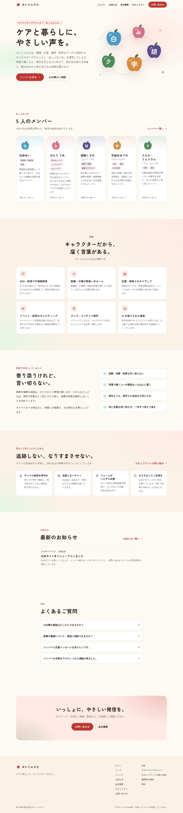
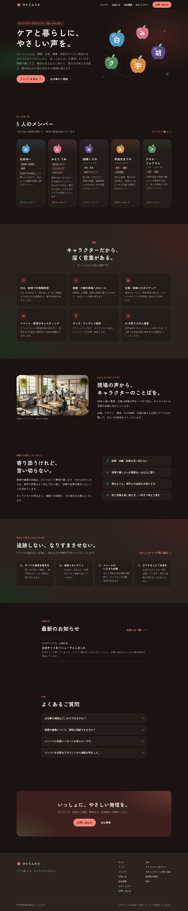
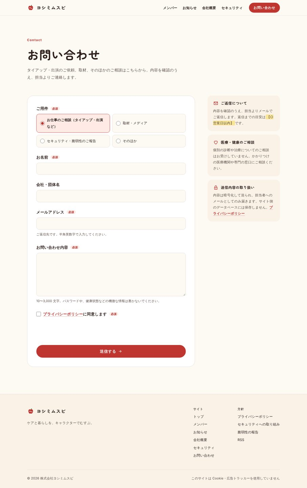

# ヨシミムスビ公式サイト（セキュリティ重視の作り直し版）

株式会社ヨシミムスビの公式サイトを、**いま主流の「静的サイト＋エッジ」の構成**で作り直したものです。
「攻撃される入口をそもそも置かない」ことを第一に、表示の速さ・アクセシビリティ・運用のしやすさも合わせて見直しています。



| スマホ | ダーク表示 | お問い合わせ |
|---|---|---|
|  |  |  |

## ひとことで言うと

- **ページはすべてビルド時に HTML として書き出す**。サーバー側でページを組み立てないので、管理画面・ログイン画面・データベースが公開されていない
- **動く部分はお問い合わせの受け口だけ**（`worker/`、テストを除いて約 500 行）。ここに入力チェック・ボット判定・送信回数制限・CSRF 対策を集中させている
- **ブラウザに「このサイトは JavaScript を一切実行しない」と宣言している**（CSP `script-src 'none'`）。仮に内容が改ざんされても、不正なスクリプトは動かない
- **Cookie・広告タグ・外部のアクセス解析なし**。フォントも自前で配信し、閲覧情報が他社に渡らない
- **更新は GitHub 経由**。内容の変更は Pull Request → 自動チェック → 人が確認して公開、の流れになる

脅威ごとの対策の一覧は [docs/SECURITY_DESIGN.md](docs/SECURITY_DESIGN.md) にまとめています。

## 構成

```
訪問者 ──HTTPS──▶ Cloudflare（WAF・Bot 対策・HSTS）
                    │
                    ├─ /api/* だけ ──▶ Worker（worker/index.ts）
                    │                   ├─ Origin 検査・入力チェック・回数制限
                    │                   ├─ Turnstile でボット判定（サーバー側で検証）
                    │                   └─ Email Routing で担当者にメール（保存しない）
                    │
                    └─ それ以外 ─────▶ 静的ファイル（dist/）＋ _headers のセキュリティヘッダー
```

| 使っているもの | 役割 | 選んだ理由 |
|---|---|---|
| [Astro](https://astro.build/) 7 | 静的サイトの生成 | 既定でクライアント側の JavaScript を出さない。内容をスキーマで検証できる |
| Cloudflare Workers（Static Assets） | 配信と問い合わせ受付 | サーバーの OS・PHP の更新作業が不要。WAF・Bot 対策と同じ場所で動く |
| Cloudflare Turnstile | ボット判定 | 画像選びのない CAPTCHA。Cookie を使わない |
| Cloudflare Email Routing | 通知メール | 外部のメール配信サービスの API キーを持たずに済む |
| GitHub Actions・Dependabot | 自動チェック・依存の更新 | 変更のたびに型・テスト・ビルド・脆弱性を点検 |

本番で使う npm パッケージは `astro` と見出し用フォントの 2 つだけです（部品が少ないほど、乗っ取られる箇所も減る）。

## ページ

| URL | 内容 | 編集する場所 |
|---|---|---|
| `/` | トップ（ヒーロー・メンバー・活動・方針・安心への取り組み・お知らせ・FAQ） | `src/pages/index.astro` |
| `/members/`・`/members/<id>/` | メンバー一覧・個別ページ | `src/content/members/*.md` |
| `/news/`・`/news/<id>/` | お知らせ | `src/content/news/*.md` |
| `/company/` | 会社概要・公式アカウント一覧 | `src/data/site.ts` |
| `/contact/` | お問い合わせフォーム | `src/pages/contact/` と `worker/` |
| `/security/` | セキュリティへの取り組み・なりすまし注意・脆弱性の報告窓口 | `src/pages/security.astro` |
| `/privacy/` | プライバシーポリシー（ひな形） | `src/pages/privacy.astro` |
| `/.well-known/security.txt` | 脆弱性報告の窓口（RFC 9116） | `public/.well-known/security.txt` |
| `/sitemap.xml`・`/robots.txt`・`/news/rss.xml`・`/llms.txt` | 検索エンジン・RSS・AI 向けの要約 | 自動生成 |

## 内容を更新する

お知らせを追加する例（`src/content/news/2026-12-event.md`）:

```markdown
---
title: 年末配信イベントに出演します
date: 2026-12-01
category: event   # info / event / goods / media
excerpt: 一覧に出る 160 文字以内の要約。
---

本文を Markdown で書きます。
```

- メンバーの SNS リンクは `x.com`・`youtube.com` の https の URL しか受け付けません（それ以外はビルドが止まる）
- イメージカラーは `#rrggbb` 形式のみ。日付や種別の書き間違いもビルド時に検出されます
- Claude に頼む場合も同じで、「お知らせを追加して PR を作って」と頼み、PR の差分を人が確認してから main に入れます

## ローカルで動かす

Node.js 22.22 以上が必要です。

```bash
cd yoshimi-secure-site
npm ci                      # .npmrc でインストール時のスクリプト実行を止めている
cp .dev.vars.example .dev.vars
npm run dev                 # 見た目の確認だけなら http://localhost:4321/
npm run preview             # 本番と同じ Workers の環境で確認（http://localhost:8787/、ヘッダーとフォームも動く）
```

Antigravity などの AI エディタでテスト環境を動かして確認する手順は [docs/ANTIGRAVITY_TEST.md](docs/ANTIGRAVITY_TEST.md) にあります。

| コマンド | 内容 |
|---|---|
| `npm run smoke` | `npm run preview` で動いているテスト環境に対し、全ページ・セキュリティヘッダー・フォームの受付を自動で確認（42 件） |
| `npm test` | お問い合わせ受付の Worker のテスト（38 件） |
| `npm run check` | 型チェック（Astro・Worker） |
| `npm run build` | ビルド＋公開前チェック（インラインのスクリプトや style 属性、`http://` のリンク、`<h1>` の数、security.txt の期限など） |
| `npm run audit` | 依存パッケージの脆弱性と、配布元の署名の点検 |

## 公開する

おすすめは **Cloudflare の Git 連携（Workers Builds）** です。GitHub に Cloudflare の API トークンを置かずに済みます。

1. このフォルダを専用の非公開リポジトリに移す（今のリポジトリは別のプログラムと同居しているため）
2. ドメイン（yoshimimusubi.com）の DNS を Cloudflare に移す。旧サーバーの不要な DNS レコードは消す
3. Cloudflare で Email Routing を有効にし、受信用アドレスを確認済みにする → `wrangler.jsonc` の `MAIL_TO` と `destination_address` に設定
4. Cloudflare で Turnstile のウィジェットを作る（ホスト名は yoshimimusubi.com）
   - サイトキー → ビルドの環境変数 `PUBLIC_TURNSTILE_SITE_KEY`
   - シークレット → `npx wrangler secret put TURNSTILE_SECRET_KEY`（ファイルには書かない）
5. Workers & Pages → 作成 → GitHub リポジトリを接続（ルート: `yoshimi-secure-site`、ビルド: `npm ci && npm run build`、デプロイ: `npx wrangler deploy`）
6. `wrangler.jsonc` の `routes` のコメントを外して独自ドメインを割り当てる
7. [docs/SECURITY_DESIGN.md の「公開前チェックリスト」](docs/SECURITY_DESIGN.md#公開前チェックリスト)を上から順に確認する

テスト用の Turnstile シークレットのまま本番に出すと、Worker が送信をすべて拒否します（設定し忘れを「閉じる側」で検知するため）。

## 費用の目安

Workers・Turnstile・Email Routing はいずれも無料枠があり、会社サイトの規模なら無料で収まる見込みです（上限は Cloudflare の料金ページで確認してください）。

## 前回のリニューアル案（EmDash 版）との違い

`claude/emdash-new-site` ブランチの EmDash 版は「管理画面と AI 用の窓口（MCP）を持つ CMS」でした。こちらはその逆で、**公開サイトに書き込みの入口を置かない**ことを優先しています。

| | EmDash 版 | この版 |
|---|---|---|
| 更新方法 | 管理画面・AI（MCP）から直接 | GitHub の PR（AI に頼む場合も PR を作ってもらう） |
| 公開されている入口 | 管理画面・API・MCP・フォーム | フォームの受け口 1 つ |
| データベース | D1・R2 | なし |
| ページの JavaScript | あり | なし（お問い合わせのボット判定のみ） |
| 向いている運用 | 更新が多く、ブラウザから手軽に直したい | 更新は月数回程度で、安全性を優先したい |

更新の手軽さが必要になったら、Git 上の Markdown を編集できる CMS（管理画面を別ドメインで認証付きにする方式）を後から足せます。

## 公開前に差し替えるもの

【】で囲んだ仮の内容があります。一覧は [docs/REPLACE_CHECKLIST.md](docs/REPLACE_CHECKLIST.md) を見てください。
